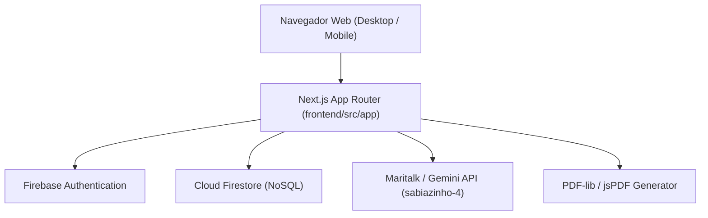

# 🏗️ Arquitetura do Sistema — SimuladoApp.Edu

## 1. Topologia da Aplicação

---

## 2. Camadas da Aplicação (`frontend/src/`)

- **`app/` (Apresentação & Rotas):**
  - Rotas principais (`/`, `/diario`, `/calendario`, `/redacao`, `/aluno`, `/atividades`).
  - Layouts raiz com injeção de fontes (`Manrope` e `Inter`) e tokens globais.
- **`components/` (Componentes Visuais Modulares):**
  - `landing/`: Landing page de vendas e AuthModal.
  - `diario/`: TabelaNotas, Sidebar, ImportModal, ProfileModal.
  - `calendario/`: CalendarioView, Sidebar, CardAula, Modais.
  - `atividades/`: Formulários e renderizadores de questões.
- **`hooks/` (Lógica de Estado e Orquestração):**
  - `useTurmas`, `useNotas`, `useCalendarioPedagogico`.
- **`lib/` (Infraestrutura & Clientes Externos):**
  - `firebase.js`, `auth-context.js`, `maritalk.js`, geradores de PDF.
- **`utils/` (Regras de Domínio Puras & Cálculos):**
  - `calculos.js` (arredondamento, médias, soma máxima).
  - `pdfExtractor.js`, `docxExtractor.js`.

---

## 3. Padrões de Projeto Adotados
- **Optimistic UI:** Atualizações imediatas na interface com persistência assíncrona em Firestore e `localStorage`.
- **Strategy Pattern para Extração de Documentos:** Suporte polimórfico a PDF, DOCX e TXT.
- **Pure Domain Functions:** Cálculos de notas isolados de dependências de interface para garantir 100% de testabilidade.

## Calendário Pedagógico — evolução segura (RN-66)

- `src/dominio/calendario/evolucao.js`: funções puras de identidade, progresso, capacidade, distribuição, remanejamento, feriados e reconciliação. Resultado inclui pendências/conflitos explícitos; histórico não equivale a vínculo ativo.
- `src/infraestrutura/calendario/CalendarioRepository.js`: snapshot turma/ano, leitura legada compatível, transação com revalidação das leituras e controle de revisão. Lotes acima do limite seguro são recusados antes de qualquer escrita; o professor deve escolher período menor.
- `src/hooks/calendario/useCalendarioPedagogico.js`: orquestra leitura/gravação e descarta respostas de contexto anterior. Dados só entram na tela quando pertencem à turma/ano atuais.
- `src/app/calendario/page.js`: Calendário, Conteúdos e Configurações; filtros explícitos, prévias e confirmação aguardada.
- Importação de arquivo reutiliza `documentExtractor`; revisão precede salvar. Horários usam o conversor estrito e leitura real do repositório Meu Horário. APIs legadas dos conversores permanecem para compatibilidade, sem uso no novo fluxo.

### Diário seguro (RN-68)
- Domínio: `criterios`, `backupTurmas`, `evolucao`, `acompanhamento` e `aprovacao` concentram validação, migração sem redefinição, restauração, patches de desfazer, ano e publicação.
- Aplicação: `FilaPersistenciaDiario` coordena gravação sequencial, rascunho recuperável, revisão, restauração confirmada, repetição e invalidação de carregamentos desmontados. A fila não é cancelada ao sair com gravação em curso.
- Infraestrutura: `DiarioRepository` usa transação no documento canônico e compara revisão + conteúdo; migração legada só quando o canônico inexiste. `ResultadoPublicacaoRepository` mantém resumo local por conta/ano. `ContextoChamadaRepository` consulta Calendário/Meu Horário somente para sugerir.
- Apresentação: hook de persistência guardado por conta, contexto ano/arquivo, visão geral, publicação com prévia/recorte, restauração com cópia e linha do tempo. Identidade de turma e bimestre continua remontando os editores. Novas exportações bimestrais convivem com as anuais.

### Gerador seguro (RN-69)
- Domínio `atividades/acessoAluno`: projeções públicas e validação de respostas.
- Infraestrutura `atividades/acessoAluno`: autorização emitida, sessão legada, vínculo atual, leitura de entrega legada e nova; leitor injetável permite revalidação transacional.
- Infraestrutura Firebase existente: lote de atividade/acessos, retomada por ID, reconciliação de tokens, bloqueio estrutural com registros e arquivamento. Cadastros completos ficam no Diário.
- Página Atividades reutiliza `usePersistenciaDiario` e aguarda a fila antes de sincronizar; recarrega a base depois da transação para manter revisão/conteúdo consistentes.
- Interface usa sincronização explícita com prévia. Compatibilidade dos componentes antigos permanece, mas ambas as entradas da página atual desativam sincronização/publicação automáticas. Similaridade não tem efeito de gravação.
- Relatórios consultam entregas por atividade autorizada e aluno, incluindo arquivadas, em vez de buscar amplamente entregas de outros professores.
